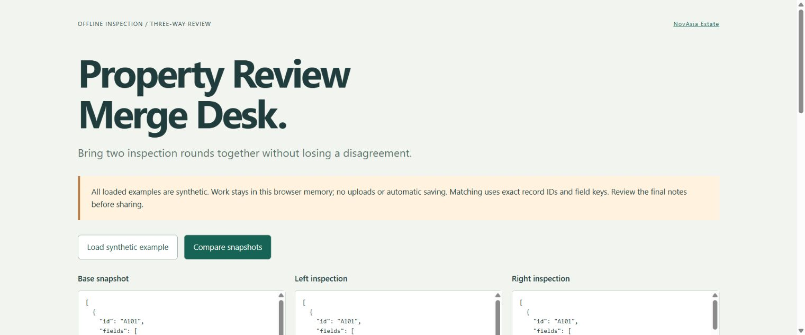

# Property Review Merge

**Three-way merge for two independently edited offline inspection snapshots.** Keep disjoint changes, detect disagreements, and require a deliberate choice before exporting a combined inspection record.

Developed by [NovAsia Estate](https://novasia.estate/). MIT licensed. Pure Elm library with a local browser desk; no server, credentials, telemetry or automatic storage.



## The problem

Two inspectors start from the same handover notes. One adds a kitchen observation and deletes an outdated bathroom item. The other changes the kitchen severity and updates the bathroom assignment. Replacing a whole file loses useful work; timestamps do not explain whether deletion was intentional.

This package compares **base, left and right** by exact record ID and field key. Disjoint edits combine automatically. Different edits to one field, delete/edit pairs and different concurrent additions become explicit conflicts. The original snapshots remain unchanged. This is distinct from an inspection log: it reconciles independent rounds rather than recording defects or scheduling their repair.

## Install

```sh
elm install novasia-estate/property-review-merge
```

```elm
import Property.ReviewMerge as Merge

-- First validate each authored List Row into an opaque Snapshot.
-- Given validated base, left and right:
plan =
    Merge.merge base left right

pending =
    Merge.conflicts plan

-- The application gathers an explicit KeepBase/KeepLeft/KeepRight choice
-- for every conflictKey. Missing, unknown or duplicate choices are errors.
result =
    Merge.finalize choices plan
```

`finalize` returns no partial output when choices are incomplete. It rechecks the combined snapshot's limits, so two valid inputs cannot silently create an oversized result. Empty field text and absent/deleted fields remain distinct.

## Browser desk

[Open the browser desk](https://novasia-estate.github.io/property-review-merge/) with the synthetic example, or build it locally:

```sh
cd demo
elm make src/Main.elm --optimize --output app.js
python -m http.server 8000 --bind 127.0.0.1
```

Open the local page. A clearly synthetic example starts with two conflicts: a kitchen note and bathroom delete/edit pair. Compare the three JSON panes, choose each source value, then prepare and download the resolved JSON. The result is also a selectable text box for browsers that restrict downloads. Changing any input immediately clears the plan, choices and old export. Nothing is persisted when the tab closes.

The library package contains no JavaScript or Elm ports. The separate demo uses normal Elm Browser/File libraries for the user interface and user-requested download. No input text is rendered as HTML.

## Data boundary

Snapshots are JSON arrays of rows with `id` and a **list** of `{ "key": "...", "value": "..." }` fields. Field lists preserve duplicates until validation; an object/dictionary representation could silently discard them. Values are plain strings; no trimming, translation, identity matching or note interpretation occurs.

Limits per validated snapshot: 200 records, 30 fields/record, 64-character ASCII record IDs, 64-character nonblank field keys, 2,000-character values. Empty snapshots and empty records are valid. The demo additionally caps each JSON input at 500,000 characters. JSON object member duplication follows the standard Elm decoder behavior; the row/field-list validation does not certify canonical JSON syntax.

36 behavioral tests cover independent edits, record and field deletion, concurrent additions, complete resolution, unknown/duplicate choices, Unicode, stable ordering, duplicate inputs, JSON roundtrip and combined-output limits. Run:

```sh
elm-test
elm make src/Property/ReviewMerge.elm src/Property/ReviewMerge/Json.elm --docs docs.json
```

Read [merge rules](https://github.com/novasia-estate/property-review-merge/blob/1.0.1/docs/merge-rules.md), [JSON contract](https://github.com/novasia-estate/property-review-merge/blob/1.0.1/docs/json-contract.md), [integration](https://github.com/novasia-estate/property-review-merge/blob/1.0.1/docs/integration.md) and [privacy/limits](https://github.com/novasia-estate/property-review-merge/blob/1.0.1/docs/privacy.md). Every example is authored synthetic data, not a real property inspection.
